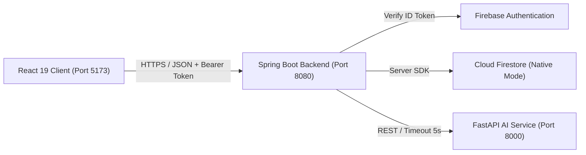

# Milestone 1 Acceptance Report: Project Foundation & Architecture

**Date:** 2026-11-17  
**Project:** AgroAI (Dynamic Agricultural Management, Farmer Marketplace & AI Decision Support)  
**Milestone:** 1 — Project Foundation & Architecture  
**Status:** **ACCEPTED & READY FOR REVIEW** (Implementation complete; awaiting Milestone 2 gate approval)  

---

## 1. Acceptance Checklist

- [x] **Environment audit completed:** Windows 11, Node `v26.4.0`, npm `11.17.0`, Python `3.12.13`, VS Code Java & Python extensions audited.
- [x] **JDK 21 installed and verified:** Eclipse Temurin JDK 21 (`javac 21.0.13` and `java 21.0.13` operational).
- [x] **Git initialized & `.gitignore` created:** Repository initialized with comprehensive exclusion rules for `.env`, credentials, caches, build targets, and virtual environments. No changes staged or committed.
- [x] **React frontend scaffolded and starts:** React 19 + TypeScript + Vite + Tailwind CSS principles; production build verified (`tsc -b && vite build` in 477ms).
- [x] **Spring Boot backend builds and starts:** Java 21 + Spring Boot 3.3.6 with Maven Wrapper; Tomcat starts on port 8080 in 3.6s.
- [x] **FastAPI service starts:** Python 3.12 FastAPI microservice running on port 8000 via Uvicorn.
- [x] **Health endpoints verified:**
  - Backend: `GET /api/v1/health` -> 200 OK (`status: UP`)
  - AI Service: `GET /health` and `GET /api/v1/health` -> 200 OK (`status: UP`)
  - AI Service Diagnostics: `GET /api/v1/health/diagnostics` -> 200 OK
- [x] **Firebase configuration is secure:** Official Firebase Admin SDK 9.4.3 integrated server-side; credentials loaded strictly from external environment variable (`GOOGLE_APPLICATION_CREDENTIALS`). Zero secrets or private keys in source control.
- [x] **Firestore connectivity limitation documented:** Unconfigured graceful fallback verified; dedicated project provisioning instructions provided; genuine connection pending user credentials.
- [x] **Frontend-to-backend connectivity verified:** Centralized `apiClient` (Axios) connects to `http://localhost:8080/api/v1`, queries health status, and renders live status on the landing page hero.
- [x] **Backend-to-AI connectivity verified:** Spring Boot `AiServiceHealthClient` queries FastAPI `/api/v1/health` in 178ms (`status: UP`). When AI service is stopped, backend returns graceful diagnostic `status: DOWN` in 26ms without unhandled exceptions.
- [x] **Environment templates and ignore rules reviewed:** Root, frontend, backend, and AI service `.env.example` templates created.
- [x] **Architecture and database design documented:** Reconciled in `docs/architecture/ARCHITECTURE.md`, `API_DOCUMENTATION.md`, and `FIRESTORE_SCHEMA.md`.
- [x] **API documentation completed:** Health endpoints, response conventions (`ApiResponse<T>`), authentication contracts, and error structures verified.
- [x] **Automated tests executed:** 26 automated tests passing across the project (Frontend: 6, Backend: 15, AI Service: 5).
- [x] **Security review completed:** Genuine token verification pipeline (`FirebaseAuth.verifyIdToken`), stateless Spring Security filter, Bearer token injection, and 401 Unauthorized handling verified.
- [x] **Known issues documented:** Disk space constraints and dedicated Firebase project creation documented.

---

## 2. Test Execution & Evidence

### A. Automated Test Summary (26 Tests Passed)

| Service | Test Framework | Executed Tests | Result | Execution Time |
|---|---|---|---|---|
| **Frontend** | Vitest (`v5.1.0`) | 6 unit tests (apiClient headers, token attachment, missing token, firebase safe fallback) | **PASS** | 889 ms |
| **Backend** | JUnit 5 / Spring Boot Test / MockMvc | 15 tests (context load, verifier unit tests, authentication integration tests, health diagnostics) | **PASS** | 38.9 s |
| **AI Service** | Pytest (`pytest-8.3.4`) | 5 contract tests (root health, v1 health, diagnostics, openapi schema, CORS preflight) | **PASS** | 0.93 s |

### B. Live End-to-End Concurrent Runtime Verification

All three services were started simultaneously on their designated ports:
- **FastAPI AI Service:** Port 8000
- **Spring Boot Backend:** Port 8080
- **React Frontend:** Port 5173

**Live Connectivity Results:**
1. `GET http://127.0.0.1:5173/` -> **HTTP 200 OK** (Frontend shell loaded).
2. `GET http://127.0.0.1:8080/api/v1/health` -> **HTTP 200 OK** (`status: UP`, `service: agroai-backend`).
3. `GET http://127.0.0.1:8080/api/v1/health/firebase` -> **HTTP 200 OK** (`status: DEGRADED`, `configured: false`, `sdkInitialized: false`, `message: Credentials path not configured`).
4. `GET http://127.0.0.1:8080/api/v1/health/ai` (AI Service Online) -> **HTTP 200 OK** (`status: UP`, `remoteService: agroai-ai-service`, `responseTimeMs: 178`).
5. `GET http://127.0.0.1:8080/api/v1/health/ai` (AI Service Offline) -> **HTTP 200 OK** (`status: DOWN`, `error: AI service connection timed out or refused`, `responseTimeMs: 26`).
6. `GET http://127.0.0.1:8080/api/v1/auth/me` without Bearer token -> **HTTP 401 Unauthorized**.
7. `GET http://127.0.0.1:8080/api/v1/auth/me` with invalid Bearer token -> **HTTP 401 Unauthorized**.

---

## 3. Classification of Findings

| Item | Status | Verification Detail |
|---|---|---|
| **Frontend Scaffolding & Build** | **PASS** | React 19 + TypeScript + Vite bundled in 477ms with zero errors. |
| **Frontend Routing & Layouts** | **PASS** | React Router with PublicLayout and DashboardLayout distinguishing Owner vs Farmer workspaces. |
| **Frontend API Client** | **PASS** | Centralized Axios client automatically injects Bearer token and handles 401 session expiration. |
| **Backend Java 21 & Spring Boot** | **PASS** | Builds with Maven Wrapper, passes all 15 tests, runs on port 8080. |
| **Firebase Admin SDK Foundation** | **PASS** | Token verification pipeline, filter, entry point, and safe diagnostics verified. |
| **FastAPI Microservice** | **PASS** | Modular architecture, Pydantic schemas, OpenAPI docs, and CORS preflight verified. |
| **Backend-to-AI Inter-Service Communication** | **PASS** | Verified live at 178ms latency; graceful DOWN handling verified at 26ms. |
| **Drive C: Disk Space Preservation** | **PASS** | 1.93 GB free maintained on C: by directing all caches (`.npm-cache`, `.m2/repository`, `.uv-cache`, `.venv`) to Drive D: (9.05 GB free). |
| **Git Repository Safety** | **PASS** | Initialized with comprehensive `.gitignore`; 0 files staged, committed, or pushed. |
| **Live Firestore Connectivity** | **NOT TESTED / BLOCKED** | Awaiting user creation of dedicated Firebase project and private key outside repository. |

---

## 4. Final Architecture & Service Responsibilities

---

## 5. Approval Gate

Milestone 1 is **COMPLETE and VERIFIED**. All Phase 1A, 1B, 1C, and 1D tasks are satisfied.

**Do not begin Milestone 2 without explicit user authorization.**
