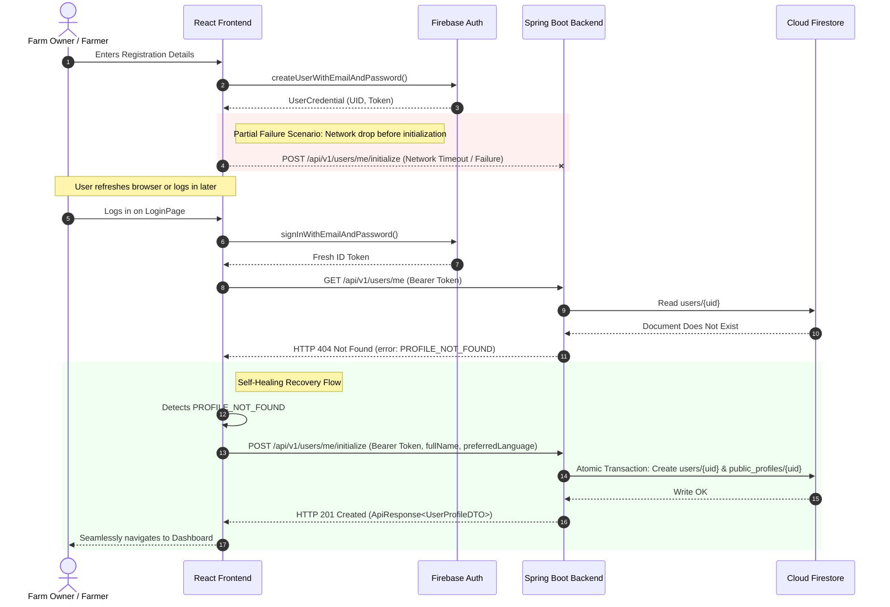
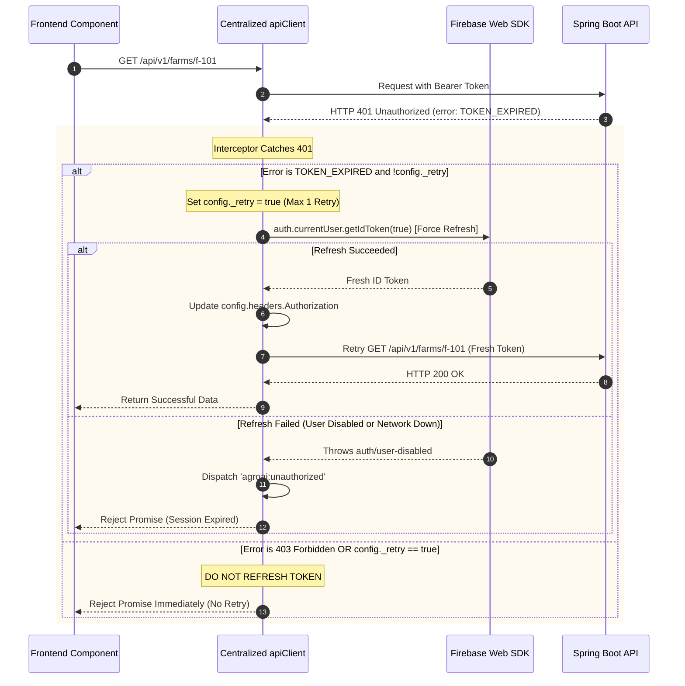

# AgroAI — Milestone 2 Implementation Plan: Authentication & User Management

> **Document Status:** REVISED PROPOSAL (v2.4) / AWAITING APPROVAL  
> **Milestone:** Milestone 2 — Authentication and User Management  
> **Author:** Antigravity Agent  
> **Target Environment:** Windows 11, VS Code, Eclipse Temurin JDK 21, Maven 3.9, Node.js 22.14, Python 3.12, Cloud Firestore, Firebase Authentication  
> **Initial Date:** November 17, 2026  
> **Revision 2.4 Date:** November 17, 2026  

---

## Revision History

| Version | Date | Author | Description of Changes |
| :--- | :--- | :--- | :--- |
| **v1.0** | 2026-11-17 | Antigravity Agent | Initial Milestone 2 implementation plan covering dedicated Firebase setup, authentication flows, Firestore schema, contextual roles, security rules, and testing matrix. |
| **v2.0** | 2026-11-17 | Antigravity Agent | Addressed first review: split profile architecture into private `users/{uid}` and `public_profiles/{uid}`, clarified client vs server logout, added basic idempotency, and expanded testing matrix. |
| **v2.1** | 2026-11-17 | Antigravity Agent | Addressed second review: detailed token revocation trade-offs, added real revocation test `M2-REV-03`, specified `POST /api/v1/users/me/initialize`, defined collision-safe key `mbr_${farmId}::${userId}`, and detailed public profile rules. |
| **v2.2** | 2026-11-17 | Antigravity Agent | Addressed third review: denied all client writes to `users/{uid}`, defined `isAssignedToField(fieldId)` with ACTIVE status, defined asymmetric profile recovery, and formulated optimistic concurrency. |
| **v2.3** | 2026-11-17 | Antigravity Agent | Addressed fourth review: defined deterministic assignment lookup path, specified Case 4 quarantine schema, formulated `profileVersion` concurrency contract, and added Admin SDK bypass notices. |
| **v2.4** | 2026-11-17 | Antigravity Agent | **Comprehensive Revision addressing Revision 2.4 Review Findings:**<br>1. **UID Encoding Collision Prevention:** Replaced mixed raw/encoded UID strategy with a single universal deterministic encoding for every UID: `safeUid = "uid_" + base64url(uid.getBytes(UTF-8))`. Mathematically proved injectivity and uniqueness, documented length bounds ($\le 175$ chars), and added tests for standard, custom, max-length, and distinct collision verification.<br>2. **Field ID Safety:** Defined strict field ID format (`^[a-zA-Z0-9-]{1,64}$`), prefixed with `fld_` in composite keys (`safeFieldId = "fld_" + fieldId`). Prohibited path-breaking characters (`/`, `..`, `::`). Verified max assignment document ID length ($\le 250$ bytes vs 1500-byte Firestore limit). Added invalid-character and boundary tests.<br>3. **Read and Write Responsibility:** Made `GET /api/v1/users/me` strictly read-only; removed all automatic reconciliation writes from GET. Established dedicated transactional, auditable reconciliation endpoint `POST /api/v1/users/me/reconcile`. Kept initialization recovery strictly separate.<br>4. **Assignment History Consistency:** Documented and tested one active assignment per `(fieldId, farmerId)` pair, transactional assignment creation/release/reassignment, historical audit trail preservation, and immediate backend/rules access denial upon inactive status. |

---

## 1. Executive Summary & Scope

Milestone 1 successfully established the project foundation, service scaffolding, inter-service health diagnostics, stateless Bearer token authentication foundation, and verified multi-service connectivity across ports 5173, 8080, and 8000.

**Milestone 2 Objective:** Implement production-grade user authentication and identity management using Firebase Authentication and Cloud Firestore, adhering to AgroAI's core architectural principle: **Roles are contextual relationships, not a mutually exclusive global enum**.

### Scope Boundaries:
- **Included in Milestone 2:**
  - Dedicated Firebase development project setup (`agroai-dev`).
  - Frontend authentication flows (Registration, Email/Password Login, Logout, Password Reset, Auth State Persistence, Token Attachment, Single-Retry Token Refresh).
  - Backend user profile domain model (`users/{uid}` and `public_profiles/{uid}` in Cloud Firestore) with validation, status lifecycle, `profileVersion` concurrency, and profile CRUD endpoints.
  - Contextual multi-role architecture foundation (decoupling identity from farm ownership and field assignments).
  - Server-side contextual authorization evaluators and standardized `ApiResponse<T>` error envelopes.
  - Cloud Firestore security rules specification and unit testing strategy.
  - Multi-tier testing suite (MockMvc/Vitest unit tests, Firebase Local Emulator tests, live integration tests).
- **Excluded from Milestone 2 (Deferred to later milestones):**
  - Full Farm and Field CRUD (Milestone 3).
  - Farmer Marketplace and Job Posting/Application flows (Milestone 4).
  - Disease Detection & AI Model Inference (Milestone 6).
  - Paid payment gateway integrations (Milestone 7).

---

## 2. Dedicated Firebase Development Project Setup Plan (`agroai-dev`)

To guarantee zero interference with existing Firebase projects on the machine (`alamdipara-digital-village`, `fir-display-1cb55`, `fir-display-f039f`, `lost-and-found-4456a`, `shuvo-milon-dev`), a clean, dedicated Firebase project must be prepared.

### 2.1 Division of Responsibilities for Setup

```
┌──────────────────────────────────────────────┐
│        USER ACTIONS (Firebase Console)       │
├──────────────────────────────────────────────┤
│ 1. Create project 'agroai-dev'               │
│ 2. Enable Email/Password Auth                │
│ 3. Create Cloud Firestore (Production mode)  │
│ 4. Register Web Client & copy config to .env │
│ 5. Generate Admin SDK JSON & save to secrets │
└──────────────────────┬───────────────────────┘
                       │ External Config Ready
                       ▼
┌──────────────────────────────────────────────┐
│        AGENT ACTIONS (Source Code)           │
├──────────────────────────────────────────────┤
│ 1. Initialize Firestore client bean in Spring│
│ 2. Build UserProfile & Repository models     │
│ 3. Implement idempotent profile initialization│
│ 4. Implement Spring Security evaluators      │
│ 5. Provide zero-secret diagnostic checks     │
└──────────────────────────────────────────────┘
```

### 2.2 Step-by-Step Setup Guide

1. **Create Dedicated Project (User Action):**
   - In [Firebase Console](https://console.firebase.google.com/), click **Add project**.
   - Project Name: `agroai-dev` (or unique ID e.g. `agroai-dev-2026`).
   - Disable Google Analytics for this development environment (optional, reduces overhead).

2. **Enable Firebase Authentication (User Action):**
   - Navigate to **Build > Authentication > Get Started**.
   - Under **Sign-in method**, enable **Email/Password**.
   - Leave "Email link (passwordless sign-in)" disabled.

3. **Initialize Cloud Firestore (User Action):**
   - Navigate to **Build > Firestore Database > Create database**.
   - Database ID: `(default)`.
   - Location: Select a nearby low-latency region (recommended: `asia-south1` Mumbai or `us-central1`).
   - Security Rules: Start in **Production mode** (all reads/writes denied by default; rules will be deployed systematically).

4. **Register Web Application (Client Configuration) (User Action):**
   - In Project Settings > General > Your apps, click the **Web** icon `</>`.
   - App Nickname: `AgroAI Web Client`.
   - Copy the configuration object and populate `frontend/.env.local`:
     ```env
     VITE_FIREBASE_API_KEY=AIzaSy...
     VITE_FIREBASE_AUTH_DOMAIN=agroai-dev.firebaseapp.com
     VITE_FIREBASE_PROJECT_ID=agroai-dev
     VITE_FIREBASE_STORAGE_BUCKET=agroai-dev.appspot.com
     VITE_FIREBASE_MESSAGING_SENDER_ID=123456789012
     VITE_FIREBASE_APP_ID=1:123456789012:web:...
     ```

5. **Generate Admin SDK Service Account (External Credential Management) (User Action):**
   - In Project Settings > **Service accounts** tab.
   - Confirm runtime: **Java**.
   - Click **Generate new private key**, then click **Generate key**.
   - **CRITICAL SECURITY REQUIREMENT:** Save the downloaded JSON file **strictly outside the Git repository**:
     - Designated External Path: `C:\Users\HP\.secrets\agroai-firebase-adminsdk.json`
   - Configure Spring Boot backend:
     - In `backend/.env` (or local environment variables):
       ```env
       FIREBASE_CREDENTIALS_PATH=C:/Users/HP/.secrets/agroai-firebase-adminsdk.json
       ```
     - In `backend/src/main/resources/application.yml`:
       ```yaml
       firebase:
         credentials-path: ${FIREBASE_CREDENTIALS_PATH:}
       ```
   - Verify `.gitignore` prevents any accidental inclusion of `.secrets` or `.json` keys.

---

## 3. Firestore User Profile Privacy, Security & Field Ownership

### 3.1 Two-Tier Profile Architecture: Private vs Public

To strictly enforce data privacy and adhere to the principle of least privilege, user profile data is split into two distinct collections:

```
┌──────────────────────────────────────────────┐       ┌──────────────────────────────────────────────┐
│                users/{uid}                   │       │            public_profiles/{uid}             │
│  (Private Profile - Owner read, SDK write)   │       │     (Public Profile - Authenticated read)    │
├──────────────────────────────────────────────┤       ├──────────────────────────────────────────────┤
│ - uid (String, Immutable)                    │       │ - uid (String, Immutable)                    │
│ - email (String, Immutable)                  │       │ - fullName (String, Mutable)                 │
│ - fullName (String, Mutable)                 │       │ - profileImageUrl (String, Mutable)          │
│ - phoneNumber (String, Mutable)              │       │ - bio (String, Mutable)                      │
│ - bio (String, Mutable)                      │       │ - preferredLanguage (String, Mutable)        │
│ - profileImageUrl (String, Mutable)          │       │ - publicRoleBadges (Array, Server-only)      │
│ - preferredLanguage (String, Mutable)        │       │ - profileVersion (Integer, Server-only)      │
│ - accountStatus (String, Server-only)        │       │ - createdAt (Timestamp, Immutable)           │
│ - authorizationMetadata (Map, Server-only)   │       │ - updatedAt (Timestamp, Server-only)         │
│ - profileVersion (Integer, Server-only)      │       └──────────────────────────────────────────────┘
│ - createdAt (Timestamp, Immutable)           │
│ - updatedAt (Timestamp, Server-only)         │
└──────────────────────────────────────────────┘
```

#### Private Profile Security Policy (`users/{uid}`):
- **Client Writes Denied:** In Cloud Firestore security rules, **all direct client writes to `users/{uid}` are denied** (`allow write: if false;`). Clients cannot create, update, or delete private documents directly via the Firebase Web SDK.
- **Backend Admin SDK Management:** All creations and mutations occur through Spring Boot backend endpoints (`POST /api/v1/users/me/initialize`, `PUT /api/v1/users/me`), where input validation, business logic, and security checks are strictly enforced.
- **Owner-Only Client Reads:** The private profile is readable by the document owner (`request.auth.uid == uid`). Direct cross-user reads are denied.

#### Public Profile Security Policy (`public_profiles/{uid}`):
- **Authenticated Directory Reads:** Any authenticated user can read public profile summaries (`allow read: if request.auth != null;`) to view farmer directories, job applicant lists, and farm owner profiles.
- **Client Writes Denied:** Direct client writes are forbidden (`allow write: if false;`); updates are synchronized exclusively by the Spring Boot backend.
- **Sensitive Field Isolation:** Private fields (`phoneNumber`, `email`, `accountStatus`, `authorizationMetadata`) are **never projected into `public_profiles/{uid}`**.

---

### 3.2 Profile Field Ownership Matrix

| Field Name | Storage Location | Client-Editable? | Backend-Controlled? | Included in Public Projection? | Description & Validation |
| :--- | :--- | :---: | :---: | :---: | :--- |
| `uid` | Both | **NO** | **YES** | **YES** | Immutable Firebase UID. Derived strictly from token. |
| `email` | `users/{uid}` only | **NO** | **YES** | **NO** | Verified email from Firebase token. Strictly private. |
| `fullName` | Both | **YES** | **NO** | **YES** | User display name (2 to 100 characters). |
| `phoneNumber` | `users/{uid}` only | **YES** | **NO** | **NO** | Private contact number (E.164 standard e.g. `+8801700000000`). |
| `profileImageUrl` | Both | **YES** | **NO** | **YES** | Valid URL string (max 500 chars). |
| `bio` | Both | **YES** | **NO** | **YES** | User experience or farm background (max 500 chars). |
| `preferredLanguage`| Both | **YES** | **NO** | **YES** | Enum: `"en"` or `"bn"`. Default `"en"`. |
| `accountStatus` | `users/{uid}` only | **NO** | **YES** | **NO** | Platform standing: `"ACTIVE"`, `"SUSPENDED"`, `"DELETED"`. |
| `authorizationMetadata`| `users/{uid}` only | **NO** | **YES** | **NO** | Internal permission flags and system markers. |
| `publicRoleBadges` | `public_profiles/{uid}` | **NO** | **YES** | **YES** | Role summaries derived by backend (e.g. `["VERIFIED_OWNER"]`). |
| `profileVersion` | Both | **NO** | **YES** | **YES** | Monotonically increasing integer (starts at 1) for optimistic concurrency. |
| `createdAt` | Both | **NO** | **YES** | **YES** | Timestamp of initial profile initialization. |
| `updatedAt` | Both | **NO** | **YES** | **YES** | Timestamp of last modification. Managed by server. |

---

## 4. Token Revocation, Session Lifecycle & Verification Trade-Offs

### 4.1 Ordinary Verification vs `verifyIdToken(idToken, true)`

Understanding the exact cryptographic and network boundaries of Firebase Authentication is vital to accurate security design:

```
┌────────────────────────────────────────────────────────────────────────────────────────┐
│ Comparison: Ordinary Verification vs Revocation Checking                               │
├──────────────────────────────────┬─────────────────────────────────────────────────────┤
│ Dimension                        │ Ordinary verifyIdToken(idToken)                     │
├──────────────────────────────────┼─────────────────────────────────────────────────────┤
│ Execution Mechanism              │ Cryptographic RS256 signature and timestamp check   │
│                                  │ against Google's public JWKS certificates in memory.│
│ Network Latency                  │ Sub-millisecond (<1ms); zero external network calls.│
│ Revocation Detection             │ DOES NOT DETECT revoked tokens or disabled users.   │
│ Cryptographic Validity Window    │ Token is accepted until its 1-hour expiration (exp).│
├──────────────────────────────────┼─────────────────────────────────────────────────────┤
│ Dimension                        │ Strict verifyIdToken(idToken, true)                 │
├──────────────────────────────────┼─────────────────────────────────────────────────────┤
│ Execution Mechanism              │ Cryptographic check PLUS outbound HTTPS request     │
│                                  │ to Google identity servers to check validSince time.│
│ Network Latency                  │ 50ms – 200ms round-trip overhead per request        │
│                                  │ (dependent on host-to-Google network proximity).    │
│ Revocation Detection             │ IMMEDIATELY DETECTS revoked tokens & disabled users.│
│ Cryptographic Validity Window    │ Rejected immediately if revoked, regardless of exp. │
└──────────────────────────────────┴─────────────────────────────────────────────────────┘
```

### 4.2 Security Limitations for Ordinary Endpoints

> **HONEST SECURITY BOUNDARY:**  
> On ordinary endpoints using standard `verifyIdToken(idToken)` (e.g. reading field telemetry, browsing farms), **a logged-out or revoked user token remains cryptographically valid until its 1-hour expiration timestamp**. Client-side logout (`signOut`) merely drops local credentials; it does NOT revoke the server-side validity of the issued JWT.

Furthermore, **ordinary token verification does NOT check AgroAI account suspension**. To enforce immediate suspension on ordinary requests without incurring the network latency of `checkRevoked=true`, the backend **must explicitly verify the user's `accountStatus` in Firestore or a local fast cache** on every request. AgroAI implements this status check during request filtering.

### 4.3 Endpoints Requiring Strict Revocation Checking (`checkRevoked = true`)

To protect sensitive and high-risk operations without crippling ordinary read throughput, the following endpoints explicitly enforce `checkRevoked = true`:

1. `DELETE /api/v1/users/me` (Account deactivation and soft-deletion)
2. `DELETE /api/v1/farms/{farmId}` (Farm deletion)
3. `POST /api/v1/farms/{farmId}/transfer-ownership` (Farm ownership transfer)
4. `POST /api/v1/farms/{farmId}/members/{memberId}/revoke` (Member dismissal)
5. Any future payment or financial settlement endpoints.

### 4.4 Suspended vs Disabled Accounts & Email Verification Requirement

1. **Firebase-Disabled Account:**
   - On client, `getIdToken(true)` throws `auth/user-disabled`.
   - On backend with `checkRevoked = true`, `verifyIdToken` throws `FirebaseAuthException` (`USER_DISABLED`). Returns `401 Unauthorized` (`ACCOUNT_DISABLED`).
2. **AgroAI-Suspended Account (`accountStatus == 'SUSPENDED'`):**
   - Handled at the application layer. The Spring Security context loads the user's Firestore profile; if `accountStatus == 'SUSPENDED'`, the request is halted immediately with `403 Forbidden` (`ACCOUNT_SUSPENDED`).
3. **Email Verification Requirement (`email_verified` claim):**
   - General browsing and read access are permitted for unverified emails.
   - **Privileged actions** (registering a farm, publishing job posts, submitting crop images/telemetry) strictly require `email_verified == true` in the verified Firebase token claims. Unverified accounts attempting privileged operations receive `403 Forbidden` with error code `EMAIL_VERIFICATION_REQUIRED`.

---

## 5. Registration Recovery, Concurrency & Read/Write Responsibilities

### 5.1 Strict Read-Only Semantics for `GET /api/v1/users/me`

> [!IMPORTANT]
> **GET REQUESTS ARE STRICTLY READ-ONLY:**  
> The endpoint `GET /api/v1/users/me` will **never silently perform a database write**. If the user profile has not been initialized, it returns `404 Not Found` with error code `PROFILE_NOT_FOUND`. It never initiates automatic reconciliation or repairs.

---

### 5.2 The Idempotent Initialization Endpoint: `POST /api/v1/users/me/initialize`

To eliminate ambiguities between registration and profile creation, Milestone 2 establishes an explicit initialization endpoint:

$$\texttt{POST /api/v1/users/me/initialize}$$

#### Strict Invariants:
1. **Zero Trust for Request Body Identity:** The endpoint extracts `uid` and `email` **exclusively from the verified Firebase ID token claims** (`token.getUid()`, `token.getEmail()`). Any `uid` or `email` supplied in the request JSON is completely ignored.
2. **Idempotent Response:** If called for a user whose profile already exists, it does not throw an error or overwrite data. It returns `200 OK` with the existing profile data. If newly created, it returns `201 Created`.

---

### 5.3 Asymmetric Profile Recovery & Quarantine Protocol

During initialization, four distinct profile existence states can occur. Each state is handled with strict mathematical determinism:

| State | `users/{uid}` | `public_profiles/{uid}` | Classification | Deterministic Handling & Recovery Action |
| :---: | :---: | :---: | :--- | :--- |
| **Case 1** | **NO** | **NO** | **Fresh User** | Atomic Firestore transaction creates both documents simultaneously with initial data (`accountStatus: "ACTIVE"`, `profileVersion: 1`). Returns `201 Created`. |
| **Case 2** | **YES** | **YES** | **Fully Initialized** | Profile is intact. Transaction verifies consistency and returns existing profile data without overwriting. Returns `200 OK`. |
| **Case 3** | **YES** | **NO** | **Missing Projection** | Asymmetric state caused by prior server crash or failed write. Transaction **rebuilds missing `public_profiles/{uid}` strictly from verified `users/{uid}` data**. Returns `200 OK`. |
| **Case 4** | **NO** | **YES** | **Corrupt Orphan Projection** | Dangerous state where public profile exists without private anchor. **RULE: NEVER reconstruct private data from public profile.** Transaction quarantines orphan record, creates `users/{uid}` anew from verified token claims, and re-syncs public profile. Returns `201 Created`. |

#### Detailed Case 4 Quarantine Protocol:
1. **Quarantine Collection:** `quarantined_public_profiles/{quarantineId}` where:
   $$\text{quarantineId} = \texttt{"qnt\_"} + \texttt{uid} + \texttt{"\_"} + \text{System.currentTimeMillis()}$$
2. **Quarantine Document Schema:**
   - `quarantineId`: String unique ID.
   - `originalUid`: String UID of the orphaned public profile.
   - `capturedAt`: Timestamp of quarantine.
   - `reason`: `"ORPHAN_PUBLIC_PROJECTION_WITHOUT_PRIVATE_PROFILE"`.
   - `originalData`: Map containing complete unverified snapshot of the orphan document.
   - `resolvedBy`: `"SYSTEM_INITIALIZE_RECOVERY"`.
   - `resolvedAt`: Timestamp of resolution.
3. **Quarantine Security Rules:** Direct client access to `quarantined_public_profiles` is completely prohibited (`allow read, write: if false;`). Only backend Admin SDK can access this collection.
4. **Transaction Failure Behavior:** The entire recovery sequence (quarantining orphan document $\rightarrow$ creating `users/{uid}` $\rightarrow$ overwriting `public_profiles/{uid}`) is executed inside a single atomic Firestore transaction (`runTransaction`). If any step fails, the entire transaction rolls back; no partial document is left, and an uninitialized profile is **never silently treated as initialized**.

---

### 5.4 Profile Concurrency Contract (`profileVersion` & Optimistic Locking)

To guarantee that concurrent profile updates do not overwrite each other:

1. **Version Field:** Both `users/{uid}` and `public_profiles/{uid}` include a numeric integer field:
   $$\texttt{profileVersion} \ge 1$$
   Initialized to `1` upon creation.
2. **Retrieval Contract:** Responses to `GET /api/v1/users/me` return `profileVersion` in the data payload.
3. **Update Contract (`PUT /api/v1/users/me`):**
   - The request payload requires `expectedVersion` (integer, `@NotNull`, `@Min(1)`).
   - Backend opens a Firestore transaction (`runTransaction`).
   - Reads both `users/{uid}` and `public_profiles/{uid}`.
   - Validates:
     $$\texttt{users.getLong("profileVersion")} == \texttt{request.getExpectedVersion()}$$
   - **Conflict Handling:** If the submitted `expectedVersion` does not match `users.profileVersion`, the transaction aborts and returns:
     $$\text{HTTP } 409 \text{ Conflict} \quad (\text{error code: } \texttt{STALE\_PROFILE\_VERSION})$$
     along with the current version, forcing the client to reload and reapply modifications.
   - **Commit Execution:** If versions match:
     - Sets `newVersion = currentVersion + 1`.
     - Updates client-editable fields in `users/{uid}` with `profileVersion: newVersion` and `updatedAt: FieldValue.serverTimestamp()`.
     - Updates matching projected fields in `public_profiles/{uid}` with `profileVersion: newVersion` and `updatedAt: FieldValue.serverTimestamp()`.

---

### 5.5 Dedicated Profile Projection Reconciliation Operation

If `users/{uid}` and `public_profiles/{uid}` become inconsistent (e.g. following a system anomaly):

- **Canonical Truth:** `users/{uid}` is strictly canonical.
- **Dedicated Endpoint:** `POST /api/v1/users/me/reconcile` (or administrative batch service).
- **Execution:**
  - Protected by backend authorization (`@PreAuthorize("isAuthenticated()")`).
  - Runs in `runTransaction()`. Reads canonical `users/{uid}` and projectable fields.
  - Updates `public_profiles/{uid}` with matching data and sets `profileVersion = users.profileVersion`.
  - Writes an auditable record to `activity_logs/{logId}` documenting the reconciliation event.

---

### 5.6 Frontend Registration Recovery Flow



---

## 6. Contextual Multi-Role Architecture, Deterministic Paths & Safety

### 6.1 Universal Deterministic UID Encoding Strategy

To guarantee that **every valid Firebase UID produces a unique, path-safe, collision-free document identifier**, AgroAI employs a universal encoding algorithm without branching:

$$\text{safeUid}(u) = \texttt{"uid\_"} + \text{Base64.getUrlEncoder().withoutPadding().encodeToString}(u\text{.getBytes(StandardCharsets.UTF\_8)})$$

#### Mathematical Guarantee of Injectivity & Collision Freedom:
1. **UTF-8 Byte Encoding:** The mapping $u \mapsto u\text{.getBytes(UTF-8)}$ is an injective function from Unicode character sequences to byte arrays.
2. **Base64URL Without Padding:** RFC 4648 Base64URL without padding is a bijective function from byte arrays to ASCII strings consisting strictly of `[A-Za-z0-9_-]`.
3. **Constant Namespace Prefix:** The `"uid_"` prefix establishes an unambiguous namespace.
4. **Collision Freedom Proof:**
   $$\forall u_1, u_2 \in \text{String}: u_1 \neq u_2 \iff \text{safeUid}(u_1) \neq \text{safeUid}(u_2)$$
   Distinct original UIDs are mathematically guaranteed to produce distinct document identifiers.

#### Document ID Length Bounds:
- Firebase UIDs can be up to 128 characters (maximum 128 bytes for ASCII, or up to 512 bytes for extreme 4-byte Unicode).
- Base64URL expansion factor is $\lceil \text{bytes} \times 4/3 \rceil$. For a 128-byte ASCII UID, the encoded string is $\lceil 128 \times 4/3 \rceil = 171$ characters.
- With the `uid_` prefix (4 chars), total length is $\le 175$ characters.
- Firestore document ID limit is **1,500 bytes**. 175 characters represents **~11.6% of the limit**, ensuring total safety.

---

### 6.2 Field ID Safety & Deterministic Document Key Bounds

#### Permitted Field ID Format:
AgroAI system-generated field IDs adhere strictly to:
$$\texttt{fieldId} \in \texttt{\^{}[a-zA-Z0-9-]\{1,64\}\$}$$
Validated via Java Bean Validation `@Pattern(regexp = "^[a-zA-Z0-9-]{1,64}$")`.
- Path-breaking characters (such as `/`, `..`, `::`, spaces, or non-ASCII characters) are strictly rejected with HTTP 400 (`INVALID_FIELD_ID`).
- In composite keys, every field ID is prefixed with `fld_`:
  $$\text{safeFieldId} = \texttt{"fld\_"} + \texttt{fieldId}$$

#### Composite Key Format & Document Path Bounds:
1. **Farm Membership Document ID:**
   $$\text{Membership Doc ID} = \texttt{"mbr\_"} + \texttt{farmId} + \text{"::"} + \text{safeUid}(userId)$$
   *Max Length:* `4 + 64 + 2 + 175 = 245 bytes` (Firestore limit: 1500 bytes).
2. **Field Assignment Document ID:**
   $$\text{Assignment Doc ID} = \texttt{"asgn\_"} + \text{safeFieldId} + \text{"::"} + \text{safeUid}(farmerId)$$
   $$\text{Full Path} = \texttt{field\_assignments/asgn\_fld\_}\$\{\texttt{fieldId}\}::\$\{\text{safeUid}(farmerId)\}$$
   *Max Length:* `5 + 4 + 64 + 2 + 175 = 250 bytes` (< 17% of Firestore 1500-byte limit).

---

### 6.3 Assignment History Consistency & Lifecycle Invariants

> **CRITICAL FIRESTORE SECURITY RULES LIMITATION:**  
> Cloud Firestore Security Rules **do NOT support arbitrary collection queries** (no `where(...)` filtering). Security rules can ONLY evaluate access through known document paths using `get()` and `exists()`.

#### Assignment Lifecycle Rules:
1. **One Active Assignment per `(fieldId, farmerId)` Pair:**
   The deterministic key `asgn_fld_${fieldId}::${safeUid(farmerId)}` guarantees that a farmer has at most ONE active assignment document per field.
2. **Transactional Lifecycle Operations:**
   - **Creation:** `runTransaction` verifies the farmer's membership and checks if an assignment document exists. If an assignment exists with `status == "ACTIVE"`, creation is rejected as duplicate. If no active assignment exists, creates record with `status: "ACTIVE"`, `assignedAt: serverTimestamp()`, `assignedBy: uid`.
   - **Release:** `runTransaction` reads current assignment, validates `status == "ACTIVE"`, updates `status: "COMPLETED"`, sets `releasedAt: serverTimestamp()`, `releaseReason: reason`. An assignment history record is archived to `field_assignment_history` or preserved in audit logs.
   - **Immediate Access Termination:** When `status` changes to `COMPLETED` or `TERMINATED`, `isAssignedToField(fieldId)` in Firestore rules immediately returns false (`status != 'ACTIVE'`). Spring Boot `FieldSecurityEvaluator` queries assignment status and immediately returns `403 Forbidden` (`INSUFFICIENT_PERMISSIONS`).
3. **Preservation of Assignment History:**
   Assignment records are never hard-deleted. Historical assignment records remain queryable by farm owners in the assignment history archive.

---

### 6.4 Detailed Action-Specific Permission Matrix

| Capability | OWNER | MANAGER | OBSERVER | Assigned FARMER |
| :--- | :---: | :---: | :---: | :---: |
| **Edit Farm Profile & Visibility** | ✅ | ❌ | ❌ | ❌ |
| **Delete Farm / Transfer Ownership** | ✅ | ❌ | ❌ | ❌ |
| **Invite / Manage Members & Roles** | ✅ | ❌ | ❌ | ❌ |
| **Create / Archive Fields** | ✅ | ✅ | ❌ | ❌ |
| **Publish Job Posts & Review Applicants** | ✅ | ✅ | ❌ | ❌ |
| **Assign / Release Farmers on Fields** | ✅ | ✅ | ❌ | ❌ |
| **Submit Telemetry & Crop Images** | ✅ | ✅ | ❌ *(Denied)* | ✅ *(Assigned fields only)* |
| **Perform Field Management Operations** | ✅ | ✅ | ❌ *(Denied)* | ❌ |
| **View Farm Analytics & Records** | ✅ | ✅ | ✅ *(Read-only)*| ❌ *(Assigned fields only)* |
| **View Assigned Field Data** | ✅ | ✅ | ✅ *(Read-only)*| ✅ |

> **IMPORTANT PRINCIPLE:** An **OBSERVER** holds strictly read-only privileges. Observers **cannot submit telemetry, upload crop images, or perform any operational or management actions.**

---

### 6.5 Spring Boot Independent Authorization Enforcement

> [!CRITICAL]
> **FIREBASE ADMIN SDK BYPASS WARNING:**  
> The Firebase Admin SDK operates with full service-account administrative privileges and **completely bypasses Cloud Firestore Security Rules**. Therefore, Spring Boot **must independently enforce all role, membership, field assignment, and resource permissions in Java code** prior to executing any Firestore read or write. Firestore Security Rules serve solely to protect direct client-side Web SDK access.

---

## 7. Frontend Token Refresh & Single-Retry Interceptor

### 7.1 Single-Retry Axios Interceptor Architecture

To maintain seamless sessions while completely preventing infinite retry loops or invalid refreshes:



### 7.2 Interceptor Guard Rules
1. **Strict 1-Retry Ceiling:** The request configuration carries `_retry: boolean`. If an endpoint returns 401 and `_retry === true`, the request **is aborted immediately** to prevent an infinite loop.
2. **Explicit 403 Immunity:** If the server returns `403 Forbidden` (`INSUFFICIENT_PERMISSIONS` or `ACCOUNT_SUSPENDED`), **no token refresh is attempted**. A 403 indicates a permissions or standing failure, not an expired token.
3. **Concurrent Request Queue:** If multiple parallel requests encounter 401 simultaneously, they hook into a single shared refresh Promise rather than firing parallel `getIdToken(true)` calls.
4. **Invalid / Disabled Handling:** If `getIdToken(true)` throws `auth/user-disabled` or fails, local storage is purged, `agroai:unauthorized` is broadcast, and the UI redirects to `/login?reason=disabled`.

---

## 8. Cloud Firestore Security Rules Specification

```javascript
rules_version = '2';
service cloud.firestore {
  match /databases/{database}/documents {

    // Helper functions
    function isAuthenticated() {
      return request.auth != null && request.auth.uid != null;
    }

    function isOwner(uid) {
      return isAuthenticated() && request.auth.uid == uid;
    }

    function membershipDocId(farmId, safeUid) {
      return 'mbr_' + farmId + '::' + safeUid;
    }

    function isFarmMember(farmId) {
      // Direct membership lookup using safeUid helper or authenticated token
      return isAuthenticated() && 
        exists(/databases/$(database)/documents/farm_members/$(membershipDocId(farmId, request.auth.token.safeUid))) &&
        get(/databases/$(database)/documents/farm_members/$(membershipDocId(farmId, request.auth.token.safeUid))).data.status == 'ACTIVE';
    }

    function assignmentDocPath(fieldId, safeFarmerUid) {
      return /databases/$(database)/documents/field_assignments/$( 'asgn_fld_' + fieldId + '::' + safeFarmerUid );
    }

    function isAssignedToField(fieldId) {
      return isAuthenticated() &&
        exists(assignmentDocPath(fieldId, request.auth.token.safeUid)) &&
        get(assignmentDocPath(fieldId, request.auth.token.safeUid)).data.status == 'ACTIVE' &&
        get(assignmentDocPath(fieldId, request.auth.token.safeUid)).data.fieldId == fieldId &&
        get(assignmentDocPath(fieldId, request.auth.token.safeUid)).data.farmerId == request.auth.uid;
    }

    // --- Private Users Collection ---
    match /users/{uid} {
      // Strictly private: only document owner can read their private profile
      allow read: if isOwner(uid);
      
      // All direct client writes DENIED.
      // Spring Boot Admin SDK exclusively manages creation, updates, and deletion.
      allow write: if false;
    }

    // --- Public Profiles Collection ---
    match /public_profiles/{uid} {
      // Any authenticated user can read public profile summaries
      allow read: if isAuthenticated();
      
      // Direct client writes strictly prohibited; synchronized exclusively by Spring Boot backend
      allow write: if false;
    }

    // --- Quarantined Public Profiles (Internal Recovery) ---
    match /quarantined_public_profiles/{quarantineId} {
      // Strictly backend-only; all client reads and writes denied
      allow read, write: if false;
    }

    // --- Farms Collection ---
    match /farms/{farmId} {
      // Public farms readable by visitors; private farms readable only by active members
      allow read: if resource.data.visibility == 'PUBLIC' || isFarmMember(farmId);
      
      // Client writes disabled; managed exclusively by Spring Boot backend
      allow write: if false;
    }

    // --- Farm Members Collection (Roster Privacy) ---
    match /farm_members/{membershipId} {
      // Members of the same farm can view membership roster; non-members denied
      allow read: if isAuthenticated() && isFarmMember(resource.data.farmId);
      allow write: if false;
    }

    // --- Fields Collection ---
    match /fields/{fieldId} {
      // Farm members (Owner, Manager, Observer) or actively assigned farmers can read
      allow read: if isAuthenticated() && (isFarmMember(resource.data.farmId) || isAssignedToField(fieldId));
      allow write: if false;
    }

    // --- Field Assignments Collection ---
    match /field_assignments/{assignmentId} {
      // Assigned farmer or active farm members can view assignments
      allow read: if isAuthenticated() && (
        resource.data.farmerId == request.auth.uid || 
        isFarmMember(resource.data.farmId)
      );
      allow write: if false;
    }

    // Default deny for all other paths
    match /{document=**} {
      allow read, write: if false;
    }
  }
}
```

---

## 9. Comprehensive Testing Strategy & Expanded Matrix

Milestone 2 testing is split across three distinct tiers to provide complete coverage:

1. **Tier 1: Mock & Unit Tests (Local, In-Memory):**
   - Spring Boot `MockMvc` with mock `FirebaseTokenVerifier`.
   - Frontend Vitest tests with mocked `AuthContext` and Axios mock adapter.
2. **Tier 2: Firebase Local Emulator Tests (Firestore Rules & Database):**
   - Node.js test runner using `@firebase/rules-unit-testing`.
   - Validates document privacy, composite key access, client write denial, and rule enforcement without incurring cloud costs.
3. **Tier 3: Real Integration Tests (Dedicated `agroai-dev` Project):**
   - End-to-end authentication, genuine RS256 token issuance, real revocation testing, and real Firestore document reads/writes.

### 9.1 Expanded Test Matrix

| Test ID | Test Category & Scenario | Execution Layer | Tool / Framework | Classification | PASS Criteria |
| :--- | :--- | :--- | :--- | :--- | :--- |
| **M2-REG-01** | Duplicate profile initialization attempt (`POST /initialize`) | Backend Service | JUnit 5 + Mockito | **Mock** | Returns idempotent 200 OK with existing profile; 0 duplicate records created. |
| **M2-REG-02** | Partial registration recovery (missing profile retry) | Backend + DB | Spring Boot Test + Firestore | **Real Integration** | User authenticates with valid UID; missing profile is recreated without error. |
| **M2-CON-01** | Concurrent profile initialization race condition | Backend Service | Spring Boot Test + ExecutorService | **Mock** | Exactly 1 creation committed; concurrent call receives existing profile without error. |
| **M2-CON-02** | Concurrent profile updates race condition (`PUT /users/me`) | Backend Service | Spring Boot Test + ExecutorService | **Mock** | Optimistic concurrency rejects stale update with 409 Conflict; consistent state maintained. |
| **M2-CON-03** | Simultaneous updates using identical `expectedVersion` | Backend Controller | MockMvc + ExecutorService | **Mock** | First commit succeeds (200 OK, version+1); second commit returns 409 Conflict (`STALE_PROFILE_VERSION`). |
| **M2-REC-01** | Dedicated profile reconciliation execution | Backend Service | Spring Boot Test + Firestore | **Mock** | Corrects desynced `public_profiles/{uid}` from canonical `users/{uid}` and writes audit log. |
| **M2-REV-01** | Revoked token rejection under `checkRevoked=true` | Backend Security | MockMvc + Mock Admin SDK | **Mock** | Returns 401 Unauthorized with code `TOKEN_REVOKED`. |
| **M2-REV-02** | Disabled Firebase user access rejection | Backend Security | Spring Boot + Live Firebase | **Real Integration** | `verifyIdToken(..., true)` throws `USER_DISABLED`; backend returns 401. |
| **M2-REV-03** | **Real Token Revocation Verification** | Backend Security | Live Firebase Admin SDK | **Real Integration** | Genuine user tokens revoked via `revokeRefreshTokens()`; `verifyIdToken(..., true)` rejects token while ordinary verification accepts it until `exp`. |
| **M2-SUS-01** | Suspended AgroAI account access denial | Backend Controller | MockMvc + Mock User Context | **Mock** | Returns 403 Forbidden with `ACCOUNT_SUSPENDED` code. |
| **M2-SEC-01** | Direct client write to private `users/{uid}` | Firestore Rules | `@firebase/rules-unit-testing` | **Emulator** | Denied with `PERMISSION_DENIED` (`allow write: if false;`). |
| **M2-SEC-02** | Direct client write to `public_profiles/{uid}` | Firestore Rules | `@firebase/rules-unit-testing` | **Emulator** | Denied with `PERMISSION_DENIED` (`allow write: if false;`). |
| **M2-SEC-03** | Direct client read/write to `quarantined_public_profiles` | Firestore Rules | `@firebase/rules-unit-testing` | **Emulator** | Denied with `PERMISSION_DENIED` (`allow read, write: if false;`). |
| **M2-PRV-01** | Private profile isolation (User A reads User B `users/{uid}`)| Firestore Rules | `@firebase/rules-unit-testing` | **Emulator** | Denied with `PERMISSION_DENIED`. |
| **M2-PRV-02** | Public profile read access (`public_profiles/{uid}`) | Firestore Rules | `@firebase/rules-unit-testing` | **Emulator** | Permitted for any authenticated user. |
| **M2-KEY-01** | Standard Firebase UID encoding test | Backend Utility | JUnit 5 Unit Test | **Mock** | Encodes 28-char base62 UID deterministically with `uid_` prefix. |
| **M2-KEY-02** | Custom UID with punctuation encoding test | Backend Utility | JUnit 5 Unit Test | **Mock** | Safely encodes `auth0\|user`, `usr:123/abc`, `test@agroai.org` via Base64URL without slashes. |
| **M2-KEY-03** | Collision test: Distinct UIDs produce distinct IDs | Backend Utility | JUnit 5 Unit Test | **Mock** | Asserts $\text{safeUid}(u_1) \neq \text{safeUid}(u_2)$ for any $u_1 \neq u_2$. |
| **M2-KEY-04** | Boundary test: Maximum 128-char UID encoding | Backend Utility | JUnit 5 Unit Test | **Mock** | Encoded result $\le 175$ characters; asserts within Firestore limits. |
| **M2-KEY-05** | Deterministic repeated encoding test | Backend Utility | JUnit 5 Unit Test | **Mock** | Asserts $\text{safeUid}(u) == \text{safeUid}(u)$ across multiple independent runs. |
| **M2-FLD-01** | Invalid character rejection in field ID (`/`, `..`, `::`) | Backend Validator | JUnit 5 Unit Test | **Mock** | Validation rejects path-breaking characters with 400 Bad Request. |
| **M2-FLD-02** | Boundary test: 64-char field ID composite length | Backend Validator | JUnit 5 Unit Test | **Mock** | Composite assignment document ID is $\le 250$ bytes (< 17% of Firestore 1500-byte limit). |
| **M2-ASG-01** | Single active assignment enforcement | Backend Service | Spring Boot Test + Firestore | **Mock** | Creating second active assignment for same `(fieldId, farmerId)` rejected. |
| **M2-ASG-02** | Transactional release and immediate access termination | Backend Evaluator | Spring Boot MockMvc | **Mock** | Released farmer (`COMPLETED` status) denied access with 403 Forbidden. |
| **M2-ASG-03** | Assignment history preservation on release | Backend Service | Spring Boot Test + Firestore | **Mock** | Released assignment retained in history archive; never deleted. |
| **M2-AUT-01** | Cross-farm access denial (Member of Farm A requests Farm B)| Backend Evaluator | Spring Boot MockMvc | **Mock** | `FarmSecurityEvaluator` returns false; HTTP 403 Forbidden returned. |
| **M2-AUT-02** | Unassigned field access denial (Farmer on Field 1 reads Field 2)| Backend Evaluator | Spring Boot MockMvc | **Mock** | Returns HTTP 403 Forbidden. |
| **M2-AUT-03** | Assigned farmer reads assigned field | Firestore Rules | `@firebase/rules-unit-testing` | **Emulator** | Permitted by `isAssignedToField(fieldId)` point lookup. |
| **M2-AUT-04** | Terminated assignment denies field access | Firestore Rules | `@firebase/rules-unit-testing` | **Emulator** | Denied when document `status != 'ACTIVE'`. |
| **M2-REF-01** | Frontend automatic retry on `TOKEN_EXPIRED` | Frontend Client | Vitest + Axios Mock | **Mock** | Interceptor calls `getIdToken(true)`, attaches token, retries successfully. |
| **M2-REF-02** | No token refresh on `403 Forbidden` | Frontend Client | Vitest + Axios Mock | **Mock** | Request fails immediately with 403; `getIdToken` is NOT called. |
| **M2-REF-03** | Frontend infinite retry loop prevention (max 1 retry) | Frontend Client | Vitest + Axios Mock | **Mock** | If retried call returns 401, error rejected immediately; no second retry. |

---

## 10. Real Revocation Integration Test Specification (`M2-REV-03`)

To empirically verify token revocation behavior without relying on mocks:

### Test Protocol:
1. **Prerequisites:** Dedicated `agroai-dev` project configured with valid credentials in `C:\Users\HP\.secrets\agroai-firebase-adminsdk.json` and active network access.
2. **Step 1 (User Creation & Authentication):** A dedicated integration test account (`test-revocation@agroai.org`) is created in Firebase Auth.
3. **Step 2 (Token Acquisition):** The test harness acquires a genuine RS256 Firebase ID token and refresh token via Firebase Auth REST API.
4. **Step 3 (Baseline Verification):**
   - Execute `verifyIdToken(idToken, false)` $\rightarrow$ **PASS** (Cryptographically valid).
   - Execute `verifyIdToken(idToken, true)` $\rightarrow$ **PASS** (Session active).
5. **Step 4 (Revocation Execution):**
   - Call `FirebaseAuth.getInstance().revokeRefreshTokens(testUid)`.
6. **Step 5 (Empirical Verification of Difference):**
   - Execute standard `verifyIdToken(idToken, false)` $\rightarrow$ **PASS** (Proving that ordinary verification DOES NOT detect revocation).
   - Execute strict `verifyIdToken(idToken, true)` $\rightarrow$ **FAIL** (Throws `FirebaseAuthException` with `REVOKED_ID_TOKEN`).
7. **Cleanup:** Delete test user account.

---

## 11. Phase 2A Scope Clarification & Verification Strategy

### 11.1 Detailed Scope Breakdown for Phase 2A

```
Phase 2A Boundary: Backend & Firebase Foundation Only (NO FRONTEND UI MODIFICATIONS)
```

1. **User Action Items (Manual Setup):**
   - Create `agroai-dev` in Firebase Console.
   - Enable Email/Password Auth and create Cloud Firestore.
   - Download Admin SDK service account JSON and place in `C:\Users\HP\.secrets\agroai-firebase-adminsdk.json`.
   - Update `backend/.env` with `FIREBASE_CREDENTIALS_PATH=C:/Users/HP/.secrets/agroai-firebase-adminsdk.json`.

2. **Agent Action Items (Backend Implementation Only):**
   - Initialize Firestore client bean in Spring Boot (`FirebaseConfig.java`).
   - Create `UserProfile` entity and `UserProfileDTO` / `UpdateUserProfileDTO` with Java Bean Validation.
   - Create `UserRepository` implementing Cloud Firestore read/write operations with deterministic Base64URL safe keys (`mbr_${farmId}::${safeUid}`).
   - Create `UserService` containing idempotent profile initialization (`initializeProfile`), update logic with `expectedVersion` checking, and account status checks.
   - Create `UserController` (`POST /api/v1/users/me/initialize`, `GET /api/v1/users/me`, `PUT /api/v1/users/me`, `POST /api/v1/users/me/reconcile`).
   - Implement `FarmSecurityEvaluator` foundation bean.
   - Write JUnit 5 MockMvc test suite verifying all profile endpoints, validation rules, and error handling.

3. **How Registration Will Be Tested Without Frontend UI:**
   - **Automated MockMvc Tests:** Injects simulated `FirebaseAuthenticationToken` carrying mock `FirebaseUserDetails` directly into the Spring Security Context, testing the complete controller, validation, and service pipeline.
   - **Direct REST Testing:** If live credentials are provided, a genuine Firebase ID token can be generated via a lightweight REST command or curl to Firebase Auth REST API, then passed via curl to `http://localhost:8080/api/v1/users/me/initialize`.

4. **Credential Safety Verification:**
   - The private key resides at `C:\Users\HP\.secrets\` (outside the workspace).
   - Backend `.gitignore` excludes all `.env` files and credentials.
   - `GET /api/v1/health/firebase` reports initialization state (`configured: true`) without echoing credential contents.

5. **Independence Guarantee:**
   - **Frontend source code in `frontend/` will not be touched in Phase 2A.**
   - All Phase 2A verification will be established through backend unit tests (`mvnw.cmd test`), build verification, and REST contract checks.

---

## 12. Phased Implementation Sequence & Approval Gates

```
       ┌────────────────────────────────────────────────────────┐
       │   PHASE 2A: Dedicated Firebase Setup & Profile Domain  │
       │   - User creates agroai-dev project & places key       │
       │   - Agent adds Firestore bean, UserProfile, Repos      │
       │   - Agent implements /api/v1/users/me/initialize, me   │
       │   - Automated MockMvc test suite (M2-REG-01, M2-SEC-01)│
       └───────────────────────────┬────────────────────────────┘
                                   │
                         [APPROVAL GATE 2A]
                                   │
       ┌───────────────────────────▼────────────────────────────┐
       │   PHASE 2B: Frontend Authentication Flows & UI Views   │
       │   - User places client keys in frontend/.env.local     │
       │   - Agent implements Registration, Login, Reset pages  │
       │   - Single-retry token refresh in apiClient            │
       │   - Perspective switcher (Owner vs Farmer view)        │
       │   - Automated Vitest test suite (M2-REF-01 to 03)      │
       └───────────────────────────┬────────────────────────────┘
                                   │
                         [APPROVAL GATE 2B]
                                   │
       ┌───────────────────────────▼────────────────────────────┐
       │   PHASE 2C: Contextual Authorization & Verification    │
       │   - Agent implements FarmSecurityEvaluator evaluators  │
       │   - Author firestore.rules & run emulator tests        │
       │   - Live end-to-end token verification (M2-REV-03)     │
       │   - Produce Milestone 2 Acceptance Report              │
       └───────────────────────────┬────────────────────────────┘
                                   │
                         [APPROVAL GATE 2C]
```

---

## 13. Risk and Dependency Register

| Risk / Dependency | Impact | Mitigation Strategy |
| :--- | :--- | :--- |
| **Disk Space Constraint (Drive C: 1.93 GB free)** | High | Strictly preserve Drive C space. Keep all npm caches (`D:/.npm-cache`), Maven repositories (`D:/.m2/repository`), and Python venvs on Drive D. |
| **Accidental Secret Exposure** | Critical | Service account private key is strictly stored at external host path `C:\Users\HP\.secrets\agroai-firebase-adminsdk.json`. Workspace `.gitignore` audited; no private keys in repository. |
| **Interference with Existing Firebase Projects** | Critical | Dedicated project `agroai-dev` is used exclusively. The 5 existing Firebase projects are completely isolated. |
| **Token Revocation Check Latency** | Medium | Use standard local cryptographic validation for regular high-frequency endpoints; restrict `checkRevoked = true` to high-privilege mutations. |
| **1-Hour Residual Token Acceptance Window** | Medium | Acknowledge that standard endpoints accept valid tokens until `exp`. Enforce immediate suspension checks via application-level Firestore profile queries. |
| **Partial Registration Inconsistency** | High | Explicit `POST /api/v1/users/me/initialize` endpoint with Firestore transactions, quarantine records, and client self-healing on 404. |
| **Admin SDK Security Rules Bypass** | High | Spring Boot independently verifies all ownership, membership, and assignment permissions in Java service code before any Firestore write. |
| **Frontend Privilege Escalation** | High | Frontend role toggle is strictly a presentation filter. Spring Boot enforces every database read and write against Firestore ownership documents. |

---

## 14. Next Steps

This revised document (v2.4) is submitted for review. **In strict compliance with instructions, no application source code, configuration files, dependencies, or Git state will be modified until this revised implementation plan is formally accepted.**
